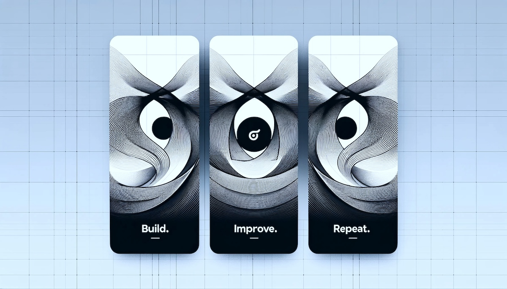

 

### Dawid Nawrocki

**Senior Growth Engineer | PLG & Experimentation | AI-First Development**

 

&nbsp;

&nbsp;

&nbsp;

&nbsp;

###

#### Now

Growth Engineer at **[Appsmith](https://github.com/appsmithorg)** — technical lead for web platform and growth systems.  
Shipping experiments, building attribution pipelines, and applying AI-first workflows to accelerate delivery 3x.

#### Toolbox

**AI-First** &mdash; Claude Code, Cursor, Lovable, v0.dev, AI Agents, LLM Integration

**Frontend** &mdash; TypeScript, React, Next.js, Gatsby, Vue, Tailwind, GSAP, Storybook

**Backend** &mdash; Node.js, Python, Serverless/Edge, REST APIs, GraphQL

**Data & Analytics** &mdash; Mixpanel, Segment, GA4, BigQuery, PostgreSQL, Supabase, Amplitude

**Growth Stack** &mdash; A/B Testing, Experimentation, Attribution, PLG, Technical SEO, CRO

**Automation** &mdash; n8n, Make.com, Zapier, Airtable, Webhooks, Lead Enrichment

**CMS & Low-Code** &mdash; Contentful, Storyblok, Webflow, Appsmith, Builder.io

**Testing & DevOps** &mdash; Jest, Playwright, Cypress, GitHub Actions, Docker, CI/CD

#### Projects

**[GrowthOS](https://growthos.fyi)** &mdash; Open-source PLG toolkit for activation specs, tracking plans, and KPI dashboards. Used by 200+ growth teams.

**PanelPack Pro** &mdash; AI-powered interview scorecard builder for hiring teams. 500+ scorecards generated.

#### Background

10+ years building acquisition systems and PLG engines for US SaaS companies.  
Previously at Stenn, Hygraph, Pilot, Ziflow, and Netguru. Freelancing since 2009.  
Sound Production postgrad. New Media Studies master's. Shipping code since forever.

###

  Build. Improve. Repeat.

