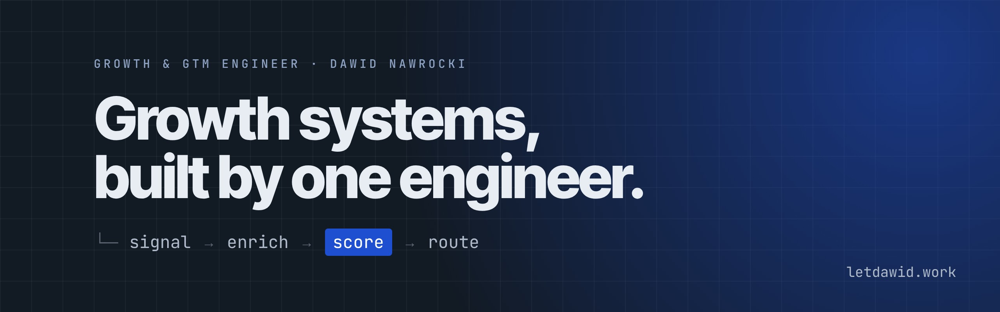

<div align="center">

<picture>
  <source media="(prefers-color-scheme: dark)" srcset="./banner-dark.jpg" />
  <source media="(prefers-color-scheme: light)" srcset="./banner-light.jpg" />
  
</picture>

<br>

### Dawid Nawrocki

**Growth & GTM Engineer · PLG, attribution & AI-native automation for B2B SaaS**

<br>

<a href="https://letdawid.work">
  
</a>
&nbsp;
<a href="https://linkedin.com/in/dawid-nawrocki">
  
</a>
&nbsp;
<a href="https://www.tiktok.com/@dawidships">
  
</a>
&nbsp;
<a href="https://x.com/groengine">
  
</a>
&nbsp;
<a href="mailto:dawid@letdawid.work">
  
</a>

</div>

###

> I'm a one-person growth team: I own the marketing site, the tracking, the pipeline and the automation, end to end.
>
> Right now I'm the growth engineer at **[Appsmith](https://github.com/appsmithorg)**, the only developer on the marketing team. I grew appsmith.com to **~45K organic sessions/month**, lifted **signup conversion by 18%** and built the **Segment → Mixpanel → Salesforce PQL pipeline** behind **$150K+ in annual pipeline**.

<br>

<table>
<tr>
<td width="50%" valign="top">

#### Build

           

</td>
<td width="50%" valign="top">

#### Growth, GTM & AI

           

</td>
</tr>
</table>

<table>
<tr>
<td width="50%" valign="top">

**[RunMend](https://runmend.app)**  
Lead-flow monitoring for HubSpot-based B2B SaaS. Canary leads run through your forms, enrichment and routing, and you hear about a silent failure before sales does.  
`building now`

</td>
<td width="50%" valign="top">

**[GrowthOS](https://growthos.fyi)**  
Open-source PLG toolkit with activation specs, tracking plans and KPI dashboards.  
`open source`

</td>
</tr>
</table>

<br>

<details>
<summary><strong>Background</strong></summary>

<br>

```
10+ years building acquisition systems and PLG engines for US & EU SaaS companies
```

| | Company | Role | Period |
|---|---|---|---|
| **>** | **Appsmith** | Growth Engineer | 2024 — now |
| | Stenn | Web Engineer (Marketing) | 2024 |
| | Hygraph | Frontend Developer (Marketing) | 2023 — 2024 |
| | Plane (formerly Pilot) | Growth Engineer | 2022 — 2023 |
| | Ziflow | Web Developer (Marketing) | 2019 — 2022 |
| | Netguru | UI Developer | 2019 |
| | Freelance | Web Developer | 2009 — now |

**Education:** Adam Mickiewicz University (New Media Studies, MA) · Polish-Japanese Academy of IT (Sound Production)

</details>

###

<div align="center">
  <sub>Build. Improve. Repeat. · Toruń, Poland · remote</sub>
</div>
